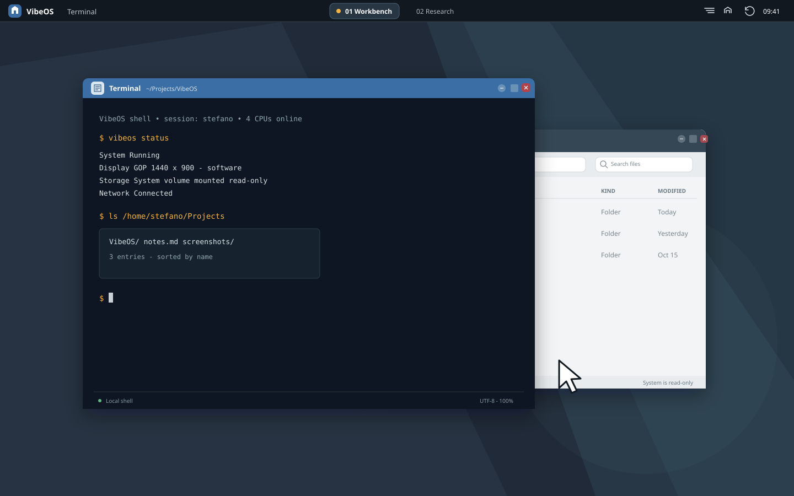
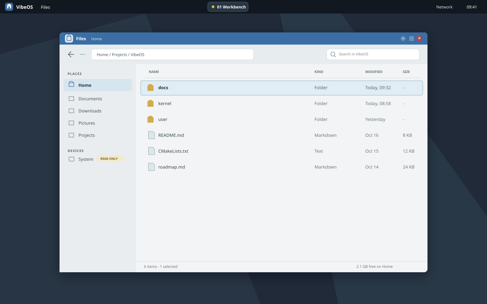
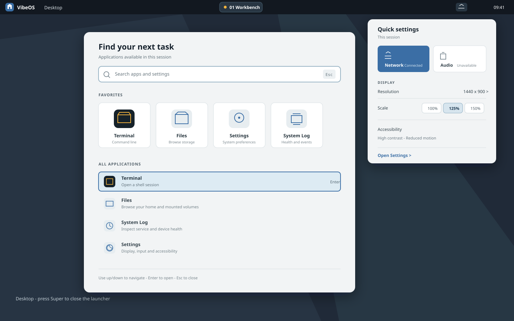
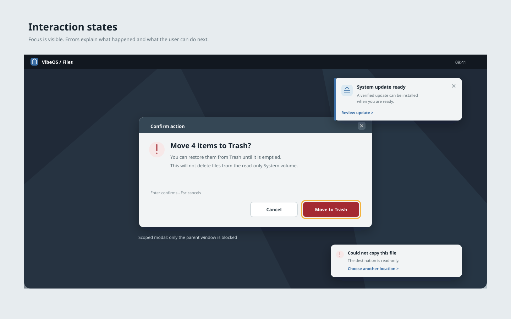
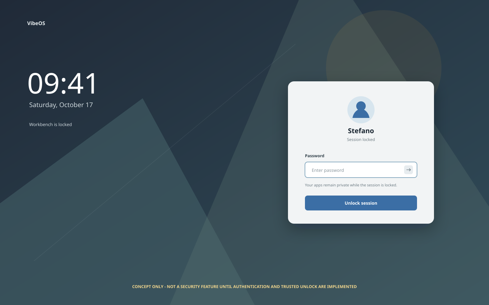

# Visual Mockups and Screen Composition

These are **design drawings**, not screenshots of the current VibeOS desktop.
They make the visual direction and hierarchy concrete for the implementing
agent. Dimensions are 1440x900 at 1x unless stated otherwise. Colors reuse the
tokens from [interaction-and-visual-system.md](interaction-and-visual-system.md).
The mockups are SVG source so they remain resolution-independent and reviewable
in Git.

## 1. Default desktop and overlapping windows

The top panel is the single persistent system rail. Workspaces sit in its
center; status and session actions are grouped at the right. A Files window
behind the focused Terminal demonstrates ordinary overlap and z-order. The
active title bar uses VibeOS blue; the inactive one stays legible without
looking disabled. The wallpaper uses quiet, large geometric planes rather than
a flat fill or animated effect. There is no permanent second dock.

## 2. File manager window

The file manager uses a stable location rail, explicit breadcrumb path, search
field, sortable list headings, file type and modified time, and a visible
read-only mount badge. The selected row has both a background and an outline;
selection is not communicated by color alone. Destructive actions remain in an
overflow/menu or confirmation flow, not adjacent to routine navigation.

## 3. Launcher and quick settings

The launcher is searchable and keyboard-first. Tiles are spacious, named and
discoverable without color. Quick settings is a separate anchored popover with
text labels and clear unavailable states; icons alone never encode a critical
state. These are overlays, not permanently competing bars.

## 4. Dialog, focus and notification states

The confirmation example shows the keyboard focus ring and separates the
destructive action. The notification is non-modal and does not steal focus. An
error variant gives a concrete next step. Modal scope is limited to its parent
window so unrelated system recovery is never blocked.

## 5. Session lock concept (approval required)

This is a visual concept only. It is **not a secure lock screen** until VibeOS
has authenticated identities, a trusted unlock path, secure-attention handling
and a policy that prevents screenshots/input capture from bypassing the lock.
Do not ship the drawing as a functioning security feature before those
requirements and the session policy are approved and implemented.

## Layout and component measurements

| Element | 1x target | Notes |
| --- | ---: | --- |
| Top panel | 40 px | Persistent; controls centered vertically |
| Window titlebar | 36 px | App identity, title and three window actions |
| Window corner radius | 8 px | Keep shadows shallow and nonessential |
| Primary button | 40 px high | Minimum 40x40 hit region; visible focus ring |
| Text field | 40 px high | Label remains visible when focused/filled |
| Sidebar | 220-240 px | Collapsible only through explicit control |
| Standard window content padding | 24 px | Reduce only in dense data views |
| Dialog width | 420-520 px | Content-driven, bounded by viewport |
| UI spacing scale | 4, 8, 12, 16, 24, 32 px | Prefer these increments; do not force all gaps equal |

Measurements scale with accessibility settings. At 125-200% scale, the
compositor must re-layout or scroll content; it must not simply enlarge clipped
bitmaps. Small screens use responsive single-column layouts and reachable
window controls.

## Icon and typography direction

- Icons are simple monoline geometry with a consistent 1.75-2 px stroke at 24
  px, squared-off terminals and restrained rounded corners. Each has a text or
  accessibility label. Avoid emoji, photorealistic glyphs and ambiguous
  platform-specific metaphors.
- Use a bundled, license-reviewed UI sans family with distinguishable `I/l/1`,
  readable numerals and broad Latin coverage; pair it with a mono face for the
  terminal. The SVG mockups use `IBM Plex Sans`/`IBM Plex Mono` with generic
  fallback; selecting and bundling fonts is an implementation gate, not an
  assumption that the font is already in the repository.
- Body copy target is 14-16 px at 1x; secondary metadata is at least 12 px and
  must remain contrast-compliant. Essential controls and status labels must not
  rely on tiny text.

## Visual implementation instructions

1. Implement these compositions first as deterministic test scenes in the
   desktop client, using the same layout primitives that real apps use.
2. Define the palette, spacing, typography, radius, elevation and focus tokens
   once in `libvibeui`; components consume tokens rather than local hex values.
3. Keep panel, titlebar, list row, menu, dialog, notification and focus states
   as separate reusable components with hover, pressed, disabled, selected,
   focused and error variants.
4. Preserve the proportions and hierarchy shown here, but adapt content to
   translations and scale. Never encode exact English text as fixed-width
   geometry.
5. Before release, compare deterministic QEMU captures with the drawings and
   run human review at 100%, 150%, keyboard-only and high-contrast settings.
   Automated screenshot assertions detect gross regressions; they do not
   replace accessibility or visual review.

The implementing agent should propose and review any material deviation from
the panel/window hierarchy, palette or keyboard model before building a second
visual language into first-party apps.
